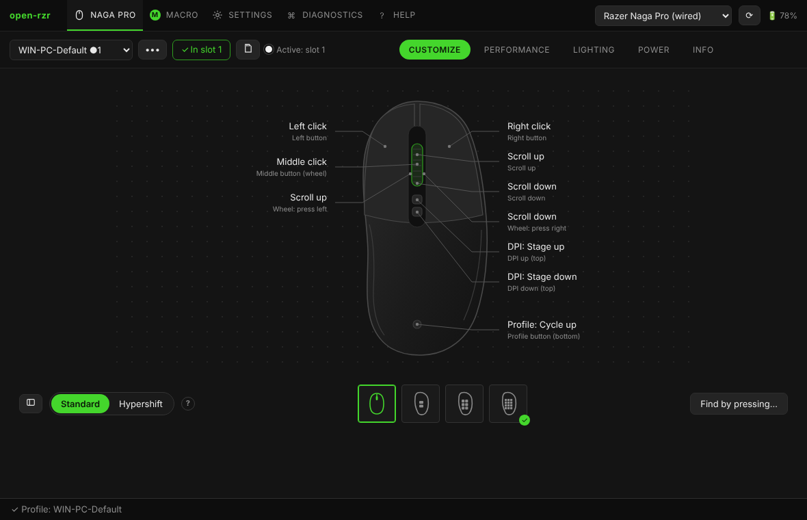
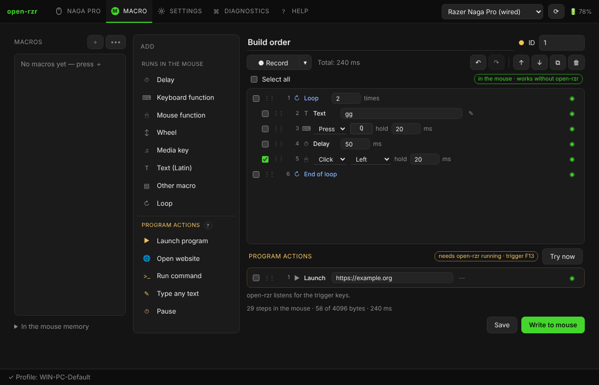

# open-rzr

[](https://github.com/aspidovss/open-rzr/releases/latest) [](https://github.com/aspidovss/open-rzr/actions/workflows/build.yml) [](LICENSE)

[Русская версия](README.ru.md)

An open-source configurator for **Razer mice** on **Windows and Linux** — first of all the **Razer Naga Pro**. Written in Rust with a Tauri window. It replaces Razer Synapse for everything the mouse itself can do.



- **No analytics, no telemetry, no accounts.** The only network request is an optional check for new versions on GitHub, which you can turn off (the program asks at first start).
- **Settings stay in the mouse.** Bindings, DPI stages, macros and lighting are written to the on-board memory and work without the program, on any computer.
- **Light in the background.** Closed to the tray it takes about **7 MB**: the window and its WebView are closed completely, only the tray, automatic profile switching and macro actions keep running.
- **Always-on local log** of every action and USB packet — one click makes a report.
- **English and Russian** interface and guide.
- **117 models known:** the Naga Pro has its own tested module; other Razer mice come from the [OpenRazer](https://openrazer.github.io) device database, current ones with buttons, macros and profiles too (experimental).
- **Works alongside OpenRazer and Polychromatic** on Linux.

> Independent project, not affiliated with Razer Inc. No Synapse code is used.
>
> Parts of the code and documentation were created with the help of AI tools and reviewed by the author. See the user agreement (`ui/legal/eula.en.txt`).

## Features

- **Customize** — every button with a drawing of the mouse, the three Naga Pro side plates (detected automatically), keys and shortcuts, mouse functions, macros, DPI and sniper, profiles, media keys, **turbo** for any button, **Hypershift** (second layer), find a button by pressing it.
- **Profiles** — a library on this computer, five on-board slots, **Write to mouse** with a clear state (an interrupted write is shown as such), **Undo** after a reset, import/export, backup/restore, profiles linked to programs.
- **Macros** — an editor like the original: recording, loops, nested macros, typed text, drag and drop, undo/redo; **program actions** (launch a program or website, run a command, type any text) performed by open-rzr through an F13–F24 trigger key.
- **Software profile** in a slot of your choice — buttons run by open-rzr itself: keys, mouse buttons and media keys held with the button, text, programs, commands; changed without writing to the mouse; they run on cable, receiver and Bluetooth alike (on Linux keys and mouse buttons go through `/dev/uinput`, opened by the udev rule).
- **Performance, lighting, power** — DPI stages, polling rate, lighting zones and effects, sleep, low power mode, battery.
- **Diagnostics** — live log, report, all HID devices, drivers left by Synapse, raw commands, Bluetooth (HID and GATT) explorer and write self-test, device description files.
- **Bluetooth (Naga Pro, Windows)** — button bindings (both layers, in the mouse's slots) and the sleep timer are written over Bluetooth too and stay in the mouse; the other settings are read. A write self-test checks what your mouse accepts.
- **Help** — the built-in guide, the same as [`ui/docs`](ui/docs/en/getting-started.md).
- **Command line** — `open-rzr-cli` and `orzr-cli` (razer-cli syntax).



## Guide

| | |
|---|---|
| [Getting started](ui/docs/en/getting-started.md) | first start, the window |
| [Profiles and writing to the mouse](ui/docs/en/profiles.md) | slots, Write to mouse, linked programs, backup |
| [Customize: buttons, Hypershift, turbo](ui/docs/en/customize.md) | binding types, side plates, Hypershift, turbo |
| [Macros](ui/docs/en/macros.md) | the editor, program actions, recording |
| [Performance, lighting, power](ui/docs/en/performance.md) | DPI, polling, lighting, sleep |
| [Supported mice and Bluetooth](ui/docs/en/devices.md) | support levels, on-board check, Bluetooth |
| [Windows and Razer Synapse](ui/docs/en/windows.md) | Synapse services, drivers |
| [Linux](ui/docs/en/linux.md) | udev, OpenRazer, Polychromatic, tray |
| [Command line](ui/docs/en/command-line.md) | `open-rzr-cli`, `orzr-cli` |
| [Troubleshooting](ui/docs/en/troubleshooting.md) | mouse not found, report, file locations |
| [Building and contributing](ui/docs/en/building.md) | build, layout, translating, device database |

## Supported devices

| Support | Models |
|---|---|
| Tested module | Razer Naga Pro — cable `1532:008F`, HyperSpeed receiver `1532:0090` |
| Tested over Bluetooth (Windows) | Razer Naga Pro `1532:0092`: buttons (both layers) and sleep timer written, the rest read |
| Naga Pro family (experimental) | Naga V2 Pro `00A7` / `00A8` |
| OpenRazer database + on-board check (experimental) | 68 current mice: Basilisk V2/V3, DeathAdder V2/V3, Viper, Cobra Pro, Naga X, Pro Click… |
| OpenRazer database | older Razer mice: DPI, polling, battery, lighting |
| Your description file | any Razer mouse with the same protocol: one `*.toml` / `*.json` per model in the `devices` folder, no recompiling |

Details: [Supported mice and Bluetooth](ui/docs/en/devices.md).

## Download and build

Releases: the [Releases](../../releases) page (Windows zip and installer, Linux tar.gz, .deb, AppImage). What changed: [RELEASE_NOTES.en.md](RELEASE_NOTES.en.md).

At first start the program shows the user agreement and asks whether to check GitHub for new versions. On Linux it offers to install the udev rule that gives your user access to the mouse (once, with the administrator password).

```powershell
# Windows (Rust + Visual Studio Build Tools)
powershell -ExecutionPolicy Bypass -File packaging\windows\build.ps1 [-Installer]
```

```bash
# Linux
./packaging/linux/build.sh [--bundles]
```

Requirements and details: [Building and contributing](ui/docs/en/building.md).

### Uninstall

- **Installer (Windows):** Settings → Apps → open-rzr → Uninstall. The uninstaller closes the program (also from the tray) and removes its autostart entry. Your settings, profile library and logs in `%APPDATA%\open-rzr` are kept unless you tick "Delete the application data".
- **Portable / AppImage / Linux:** Settings → "Remove from this computer". It turns off autostart, removes the udev rule it installed, can start the Razer services again and delete your data (`%APPDATA%\open-rzr` or `~/.config/open-rzr`), then quits; delete the program files yourself. The .deb package is removed with the package manager, together with its udev rule.

Settings already written to the mouse stay in the mouse. If you kept the Razer services from starting with Windows, start them again (Settings → Razer Synapse) before running the installer's uninstaller — it does not change them.

### Versions

Four numbers, for example **0.8.1.5**: *major* (changes the program as a whole) . *new features* . *fixes* . *optional* (intermediate updates, mostly support of particular devices). The update check tells about optional updates only when this is turned on in Settings (off by default). Cargo keeps the fourth number as build metadata (`0.8.1+5`); the installer, the file names and the release tag (`v0.8.1.5`) show `0.8.1.5`. How a release is made: [Building and contributing](ui/docs/en/building.md#releasing).

## Project layout

| | |
|---|---|
| `crates/rzr-protocol` | the 90-byte Razer report: build, parse, checksum (`no_std`, no dependencies) |
| `crates/rzr-hal` | USB/HID access: hidraw, hidapi, emulator, OpenRazer bridge; reply deadline, BUSY retries, sleeping wireless mouse |
| `crates/rzr-devices` | device database: tested modules, OpenRazer, description files, button actions |
| `crates/rzr-core` | the library: capability traits, features, macro compiler, profiles, program actions |
| `crates/rzr-cli` | `open-rzr-cli` (clap) and `orzr-cli` (razer-cli syntax) |
| `app` | the Tauri window and tray |
| `ui` | the window itself (HTML, CSS, JavaScript), translations (`ui/i18n`), the guide (`ui/docs`), the user agreement (`ui/legal`) |
| `packaging` | Windows installer, Linux packages and udev rule, CI workflow, release text (`packaging/ci/release-notes.py`) |
| `tools/uitest` | window tests in a browser against a mock — `npm test` |

`.unwrap()` / `.expect()` are not allowed outside tests (clippy). GitHub builds, tests and checks every push: [`.github/workflows/build.yml`](.github/workflows/build.yml); a `v*` tag publishes a release.

## Acknowledgements

open-rzr is built on the open work of others — first of all **[OpenRazer](https://openrazer.github.io)** (device database, report format, DPI, power and lighting commands), and also [razerqdhid](https://github.com/geezmolycos/razerqdhid), [naga-synapse](https://github.com/Renari/naga-synapse), [razer-cli](https://github.com/LoLei/razer-cli) and [Polychromatic](https://github.com/polychromatic/polychromatic). **Special thanks to the OpenRazer community.** Full list: [Acknowledgements](ui/docs/en/credits.md).

## Author and contact

[@AspidovSS](https://github.com/aspidovss) · [orzr@aspidov.ru](mailto:orzr@aspidov.ru) · bugs and ideas: [Issues](../../issues) — attach a report from **Diagnostics → Save report** (the HID device list, the mouse state and its buttons, the last log lines; open-rzr itself sends nothing anywhere).

## License

MIT. open-rzr contains no OpenRazer or Synapse code — only facts about devices and the protocol.
