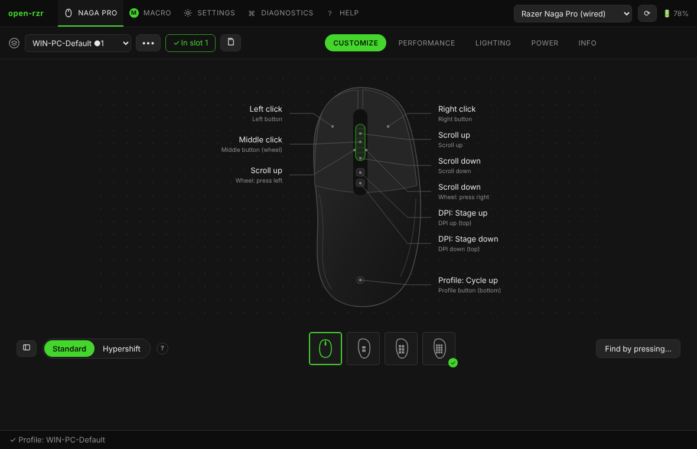
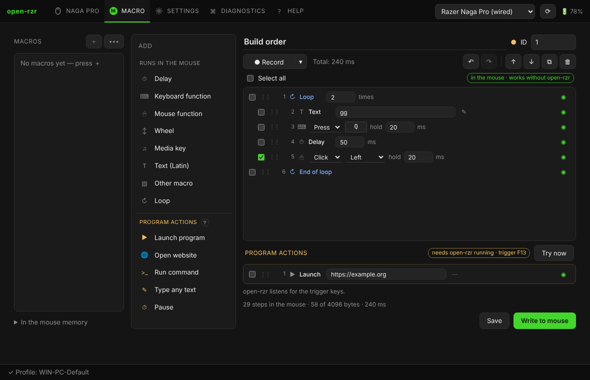

# open-rzr

[Русская версия](README.ru.md)

An open-source configurator for **Razer mice** on **Windows and Linux** — first of all the **Razer Naga Pro**. Written in Rust with a Tauri window. It replaces Razer Synapse for everything the mouse itself can do.



- **No analytics, no telemetry, no accounts.** The program never talks to the network.
- **Settings stay in the mouse.** Bindings, DPI stages, macros and lighting are written to the on-board memory and work without the program, on any computer.
- **Always-on local log** of every action and USB packet — one click makes a report.
- **English and Russian** interface and guide.
- **117 models known:** the Naga Pro has its own tested module; other Razer mice come from the [OpenRazer](https://openrazer.github.io) device database, current ones with buttons, macros and profiles too (experimental).
- **Works alongside OpenRazer and Polychromatic** on Linux.

> Independent project, not affiliated with Razer Inc. No Synapse code is used.

## Features

- **Customize** — every button with a drawing of the mouse, the three Naga Pro side plates (detected automatically), keys and shortcuts, mouse functions, macros, DPI and sniper, profiles, media keys, **turbo** for any button, **Hypershift** (second layer), find a button by pressing it.
- **Profiles** — a library on this computer, five on-board slots, **Write to mouse** with a clear state, import/export, backup/restore, profiles linked to programs.
- **Macros** — an editor like the original: recording, loops, nested macros, typed text, drag and drop, undo/redo; **program actions** (launch a program or website, run a command, type any text) performed by open-rzr through an F13–F24 trigger key.
- **Performance, lighting, power** — DPI stages, polling rate, lighting zones and effects, sleep, low power mode, battery.
- **Diagnostics** — live log, report, all HID devices, drivers left by Synapse, raw commands.
- **Help** — the built-in guide, the same as [`ui/docs`](ui/docs/en/getting-started.md).
- **Command line** — `open-rzr-cli` and `orzr-cli` (razer-cli syntax).



## Guide

| | |
|---|---|
| [Getting started](ui/docs/en/getting-started.md) | first start, the window |
| [Profiles and writing to the mouse](ui/docs/en/profiles.md) | slots, Write to mouse, linked programs, backup |
| [Customize: buttons, Hypershift, turbo](ui/docs/en/customize.md) | binding types, side plates, Hypershift, turbo |
| [Macros](ui/docs/en/macros.md) | the editor, program actions, recording |
| [Performance, lighting, power](ui/docs/en/performance.md) | DPI, polling, lighting, sleep |
| [Supported mice and Bluetooth](ui/docs/en/devices.md) | support levels, on-board check, Bluetooth |
| [Windows and Razer Synapse](ui/docs/en/windows.md) | Synapse services, drivers |
| [Linux](ui/docs/en/linux.md) | udev, OpenRazer, Polychromatic, tray |
| [Command line](ui/docs/en/command-line.md) | `open-rzr-cli`, `orzr-cli` |
| [Troubleshooting](ui/docs/en/troubleshooting.md) | mouse not found, report, file locations |
| [Building and contributing](ui/docs/en/building.md) | build, layout, translating, device database |

## Supported devices

| Support | Models |
|---|---|
| Tested module | Razer Naga Pro — cable `1532:008F`, HyperSpeed receiver `1532:0090` |
| Naga Pro family (experimental) | Naga V2 Pro `00A7` / `00A8`, Naga Pro over Bluetooth `0092` |
| OpenRazer database + on-board check (experimental) | 68 current mice: Basilisk V2/V3, DeathAdder V2/V3, Viper, Cobra Pro, Naga X, Pro Click… |
| OpenRazer database | older Razer mice: DPI, polling, battery, lighting |

Details: [Supported mice and Bluetooth](ui/docs/en/devices.md).

## Download and build

Releases: the [Releases](../../releases) page (Windows zip and installer, Linux tar.gz, .deb, AppImage).

```powershell
# Windows (Rust + Visual Studio Build Tools)
powershell -ExecutionPolicy Bypass -File packaging\windows\build.ps1 [-Installer]
```

```bash
# Linux
./packaging/linux/build.sh [--bundles]
```

Requirements and details: [Building and contributing](ui/docs/en/building.md).

## Acknowledgements

open-rzr is built on the open work of others — first of all **[OpenRazer](https://openrazer.github.io)** (device database, report format, DPI, power and lighting commands), and also [razerqdhid](https://github.com/geezmolycos/razerqdhid), [naga-synapse](https://github.com/Renari/naga-synapse), [razer-cli](https://github.com/LoLei/razer-cli) and [Polychromatic](https://github.com/polychromatic/polychromatic). **Special thanks to the OpenRazer community.** Full list: [Acknowledgements](ui/docs/en/credits.md).

## License

MIT. open-rzr contains no OpenRazer or Synapse code — only facts about devices and the protocol.
