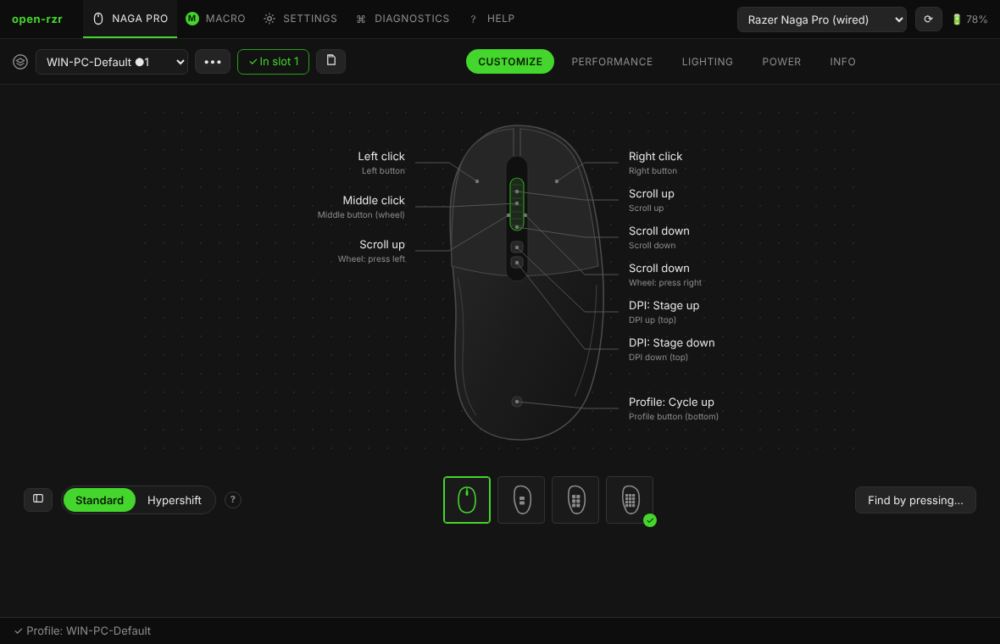
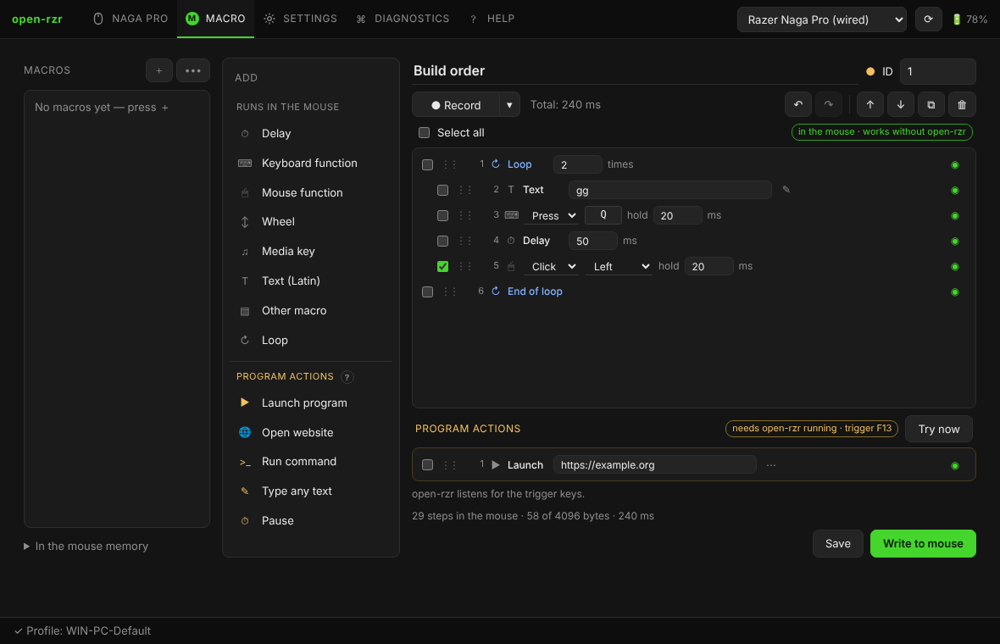

# open-rzr

[English version](README.md)

Открытая программа настройки **мышей Razer** для **Windows и Linux** — в первую очередь **Razer Naga Pro**. Написана на Rust, окно на Tauri. Заменяет Razer Synapse во всём, что умеет сама мышь.



- **Без аналитики, телеметрии и учётных записей.** Единственный сетевой запрос — необязательная проверка новых версий на GitHub, её можно выключить (программа спрашивает при первом запуске).
- **Настройки хранятся в мыши.** Назначения, стадии DPI, макросы и подсветка записываются в память мыши и работают без программы на любом компьютере.
- **Лёгкая в фоне.** Свёрнутая в трей, занимает около **7 МБ**: окно и его WebView закрываются полностью, работают только трей, автосмена профилей и действия макросов.
- **Журнал всегда включён** и хранится локально: каждое действие и пакет USB — отчёт одной кнопкой.
- Интерфейс и справка **на английском и русском**.
- **117 моделей:** для Naga Pro — свой проверенный модуль; остальные мыши Razer — из базы [OpenRazer](https://openrazer.github.io), современные — с кнопками, макросами и профилями (экспериментально).
- **Работает вместе с OpenRazer и Polychromatic** в Linux.

> Независимый проект, не связан с Razer Inc. Код Synapse не используется.
>
> Часть кода и документации создана с помощью инструментов ИИ и проверена автором. См. пользовательское соглашение (`ui/legal/eula.ru.txt`).

## Возможности

- **Настройка** — все кнопки на рисунке мыши, три боковые панели Naga Pro (определяются автоматически), клавиши и сочетания, функции мыши, макросы, DPI и снайпер, профили, медиа-клавиши, **турбо** для любой кнопки, **Hypershift** (второй слой), поиск кнопки нажатием.
- **Профили** — библиотека на компьютере, пять слотов в памяти мыши, **Записать в мышь** с понятным состоянием (оборванная запись видна), **«Вернуть»** после сброса, импорт/экспорт, резервные копии, профили для программ.
- **Макросы** — редактор как в оригинале: запись, циклы, вложенные макросы, печать текста, перетаскивание, отмена/повтор; **действия программы** (запуск программы или сайта, команда, ввод любого текста), которые выполняет open-rzr по клавише-триггеру F13–F24.
- **Производительность, подсветка, питание** — стадии DPI, частота опроса, зоны и эффекты подсветки, сон, режим экономии, батарея.
- **Диагностика** — журнал, отчёт, все HID-устройства, драйверы от Synapse, команды вручную, исследование Bluetooth (HID и GATT), файлы описаний устройств.
- **Справка** — встроенное руководство, то же, что в [`ui/docs`](ui/docs/ru/getting-started.md).
- **Командная строка** — `open-rzr-cli` и `orzr-cli` (синтаксис razer-cli).



## Руководство

| | |
|---|---|
| [Начало работы](ui/docs/ru/getting-started.md) | первый запуск, окно |
| [Профили и запись в мышь](ui/docs/ru/profiles.md) | слоты, «Записать в мышь», программы, резервные копии |
| [Настройка: кнопки, Hypershift, турбо](ui/docs/ru/customize.md) | типы назначений, панели, Hypershift, турбо |
| [Макросы](ui/docs/ru/macros.md) | редактор, действия программы, запись |
| [Производительность, подсветка, питание](ui/docs/ru/performance.md) | DPI, частота опроса, подсветка, сон |
| [Поддерживаемые мыши и Bluetooth](ui/docs/ru/devices.md) | уровни поддержки, проверка памяти, Bluetooth |
| [Windows и Razer Synapse](ui/docs/ru/windows.md) | службы Synapse, драйверы |
| [Linux](ui/docs/ru/linux.md) | udev, OpenRazer, Polychromatic, трей |
| [Командная строка](ui/docs/ru/command-line.md) | `open-rzr-cli`, `orzr-cli` |
| [Решение проблем](ui/docs/ru/troubleshooting.md) | мышь не находится, отчёт, где лежат файлы |
| [Сборка и участие](ui/docs/ru/building.md) | сборка, структура, перевод, база устройств |

## Поддерживаемые устройства

| Поддержка | Модели |
|---|---|
| Проверенный модуль | Razer Naga Pro — кабель `1532:008F`, приёмник HyperSpeed `1532:0090` |
| Семейство Naga Pro (экспериментально) | Naga V2 Pro `00A7` / `00A8`, Naga Pro по Bluetooth `0092` |
| База OpenRazer + проверка памяти (экспериментально) | 68 современных мышей: Basilisk V2/V3, DeathAdder V2/V3, Viper, Cobra Pro, Naga X, Pro Click… |
| База OpenRazer | более старые мыши Razer: DPI, частота опроса, батарея, подсветка |
| Ваш файл описания | любая мышь Razer с тем же протоколом: по одному `*.toml` / `*.json` на модель в папке `devices`, без пересборки |

Подробнее: [Поддерживаемые мыши и Bluetooth](ui/docs/ru/devices.md).

## Загрузка и сборка

Готовые версии — на странице [Releases](../../releases) (Windows: zip и установщик; Linux: tar.gz, .deb, AppImage).

```powershell
# Windows (Rust + Visual Studio Build Tools)
powershell -ExecutionPolicy Bypass -File packaging\windows\build.ps1 [-Installer]
```

```bash
# Linux
./packaging/linux/build.sh [--bundles]
```

Требования и подробности: [Сборка и участие](ui/docs/ru/building.md).

### Удаление

- **Установщик (Windows):** Параметры → Приложения → open-rzr → Удалить. Деинсталлятор закроет программу (в том числе из трея) и уберёт её автозапуск. Настройки, библиотека профилей и журналы в `%APPDATA%\open-rzr` остаются, если не отметить «Удалить данные приложения».
- **Портативная версия / AppImage / Linux:** Настройки → «Удалить с этого компьютера». Кнопка выключит автозапуск, удалит установленное программой правило udev, может снова запустить службы Razer и удалить ваши данные (`%APPDATA%\open-rzr` или `~/.config/open-rzr`), после чего программа закроется; файлы программы удалите сами. Пакет .deb удаляется менеджером пакетов вместе с правилом udev.

Настройки, уже записанные в мышь, остаются в мыши. Если вы отключали запуск служб Razer вместе с Windows, перед запуском деинсталлятора включите их снова (Настройки → Razer Synapse) — он их не трогает.

## Структура проекта

| | |
|---|---|
| `crates/rzr-protocol` | 90-байтовый отчёт Razer: сборка, разбор, контрольная сумма (`no_std`, без зависимостей) |
| `crates/rzr-hal` | доступ к USB/HID: hidraw, hidapi, эмулятор, мост к OpenRazer; срок ответа, повтор при BUSY, спящая беспроводная мышь |
| `crates/rzr-devices` | база устройств: проверенные модули, OpenRazer, файлы описаний, действия кнопок |
| `crates/rzr-core` | библиотека: трейты возможностей, функции, компилятор макросов, профили, действия программы |
| `crates/rzr-cli` | `open-rzr-cli` (clap) и `orzr-cli` (синтаксис razer-cli) |
| `app` | окно Tauri и трей |
| `tools/uitest` | тесты окна в браузере против имитации — `npm test` |

`.unwrap()` / `.expect()` вне тестов запрещены (clippy). GitHub собирает, тестирует и проверяет каждый push: [`packaging/ci/github-build.yml`](packaging/ci/github-build.yml).

## Благодарности

open-rzr построена на открытой работе других людей — прежде всего **[OpenRazer](https://openrazer.github.io)** (база устройств, формат пакетов, команды DPI, питания и подсветки), а также [razerqdhid](https://github.com/geezmolycos/razerqdhid), [naga-synapse](https://github.com/Renari/naga-synapse), [razer-cli](https://github.com/LoLei/razer-cli) и [Polychromatic](https://github.com/polychromatic/polychromatic). **Отдельная благодарность сообществу OpenRazer.** Полный список: [Благодарности](ui/docs/ru/credits.md).

## Лицензия

MIT. В open-rzr нет кода OpenRazer и Synapse — только факты об устройствах и протоколе.
