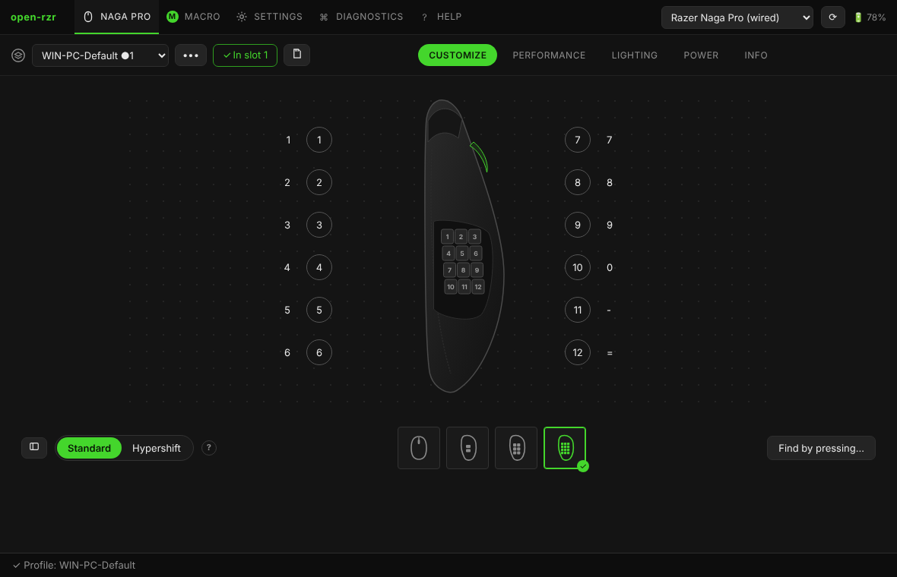

# Customize: buttons, Hypershift, turbo

The **Customize** page shows a drawing of the mouse with every binding next to its button. Click a label (or the button on the drawing) to change it; right-click for the button menu.

## Views and side plates

The buttons under the drawing switch the view: **top** and the three **side plates** of the Naga Pro (2, 6 and 12 buttons). The attached plate is detected automatically and ticked ✓; swap the plate and the page follows. The bindings of every plate are kept in the profile, so you can prepare a plate before attaching it.

**▤ list view** — all buttons as a table, with hidden ones too (*Show all*). **Find by pressing…** — press the mouse button and the page shows which one it is.

## Binding types

| Type | What it does |
|---|---|
| Keyboard | a key or a shortcut (Ctrl, Shift, Alt, Win + key). **Other key** lists keys a keyboard may not have: F13–F24, numpad, media |
| Mouse | left, right, middle, back, forward, wheel up/down/left/right; click or double click |
| Macro | a macro from the mouse memory: N times, while held, toggle, step by step |
| DPI | next / previous stage, a fixed stage, **sniper** (a DPI while held) |
| Profile | next / previous on-board profile, a fixed one |
| Multimedia | play/pause, volume, next track… |
| System | power, sleep, wake |
| Hypershift | the button holds the second layer (below) |
| Scroll mode | switches the wheel between free spin and steps |
| Off | the button does nothing |
| Default | the factory binding of this button |

The **wheel pressed sideways** is called *Wheel: press left / right*; on the Naga Pro it scrolls up and down out of the box.

## Turbo

In the binding dialog: **Turbo — Repeat while the button is held**, with an interval (50 ms by default, 20 presses a second).

- **Mouse buttons and keys** — the mouse repeats by itself, no program needed.
- **Macros** — the macro plays again and again while the button is held (mode *while held*).
- **Media keys** — the mouse has no turbo for them, so open-rzr writes a small **service macro** (id 0xF000 and up) and binds it *while held*. It takes one macro of the mouse memory and is not shown in the macro list.
- DPI, profile, Hypershift, Off — repeating makes no sense there.

## Hypershift

Hypershift is a **second layer of bindings**: while a button bound to *Hypershift* is held, the other buttons do what their Hypershift bindings say. Switch between the layers with **Standard / Hypershift** under the drawing.

1. **Make a Hypershift button**: right-click a button → *Make Hypershift button* (a side key under the thumb suits best). It keeps *Hypershift* in both layers, is marked **⇧** and cannot be changed in the Hypershift layer.
2. Switch to the **Hypershift** layer and bind the other buttons. The layer shows what is really in the mouse: an empty binding is **Not assigned** — it does not fall back to the standard one.
3. **•••** next to the layer switch: *Copy standard → Hypershift* (start from a copy), *Clear Hypershift layer*.

Notices under the drawing warn when the profile has Hypershift bindings but no Hypershift button (they never work), or a Hypershift button with an empty layer.

Macros and F13–F24 work in either layer.
