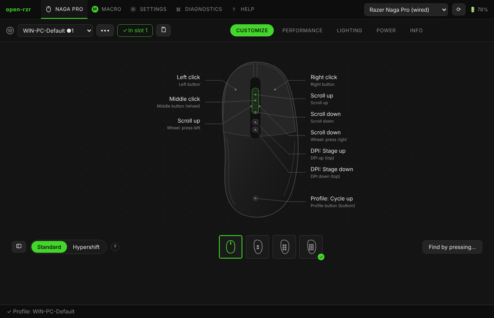

# Getting started

open-rzr configures Razer mice on Windows and Linux without Razer Synapse: no account, no analytics, no network. What you set is written into the mouse, so it keeps working on any computer — even where open-rzr is not installed.

## First start

1. **Close Razer Synapse.** Synapse and open-rzr talking to the mouse at the same time get each other's replies. When Razer software is running, a notice at the top offers **Stop Razer software** (Windows asks for administrator rights). See [Windows and Razer Synapse](windows.md).
2. **Linux only:** allow access to the mouse. On first start open-rzr offers to install a udev rule (once, with your password). See [Linux](linux.md).
3. **Pick the mouse** in the list at the top right. A cable, a HyperSpeed receiver and Bluetooth are separate entries.
4. **Make a backup** before changing anything: *••• → Backup* next to the profile. It saves all on-board profiles, both layers and the macros.

## The window

| Top tab | What is there |
|---|---|
| **Mouse** (its name) | the profile selector and the sub-tabs **Customize**, **Performance**, **Lighting**, **Power**, **Info** |
| **Macro** | the macro editor and library |
| **Settings** | language, window style, start with the system, tray, profiles, OpenRazer, Razer Synapse, about |
| **Diagnostics** | live log, report, all HID devices, drivers, raw commands |
| **Help** | this guide |

Tabs a mouse cannot use are hidden. A **?** next to a setting opens the matching part of this guide.

## Language and style

**Settings → Language**: English or Russian. **Settings → Window style**: like the original configurator (tabs on top) or classic open-rzr (sidebar).

## Next

- [Profiles and writing to the mouse](profiles.md)
- [Customize: buttons, Hypershift, turbo](customize.md)
- [Macros](macros.md)
