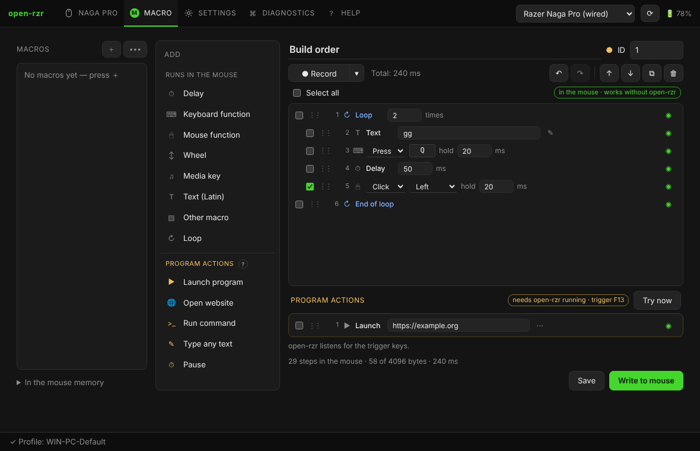

# Macros

**Macro** tab: the library on the left, what can be added in the middle, the steps on the right.

## Two kinds of steps

| Runs in the mouse | Program actions |
|---|---|
| delay, keyboard function, mouse function, wheel, media key, text (Latin), another macro, loop | launch a program, open a website, run a command, type any text, pause |
| written into the mouse; work on any computer, without open-rzr | need open-rzr running (the tray is enough) |

### Runs in the mouse

- **Keyboard function** — press (with hold time), down or up of a key.
- **Mouse function** — click, down or up of a mouse button.
- **Text (Latin)** — typed as keystrokes in the US layout: Latin letters, digits and ASCII symbols. For other languages use *Type any text* in program actions.
- **Other macro** — inserted in its place.
- **Loop** — the steps between *Loop* and *End of loop* are repeated (they are unrolled when written). With steps selected, *Loop* wraps them.

open-rzr compiles this into the on-board macro. The line under the steps shows the number of steps, the size (at most **4096 bytes**) and the total time. Switched-off steps (◉ / ○) stay in the macro but are not written.

### Program actions

The mouse cannot launch programs or type Cyrillic, so these actions are kept separately: the macro written to the mouse ends with a press of a free **F13–F24** key, and open-rzr performs the actions when it sees that key. The badge shows which key; **Try now** runs them at once.

- **Windows** — the trigger keys are registered as hot keys; other programs do not receive them.
- **Linux** — open-rzr reads the mouse's own key interface (`/dev/input/event*`; the udev rule gives access to the Razer mice' nodes only), so it works on X11 and on Wayland. Typing text needs `xdotool` (X11) or `wtype` / `ydotool` (Wayland).

## Editing

- Every step is edited in place: numbers, keys (click the key to press a new one), selects.
- Tick steps to select them; Shift+click selects a range, Ctrl+click adds one.
- Drag by **⋮⋮** to move a step (or all selected ones).
- **↑ ↓** move the selected steps, **⧉** duplicates, **🗑** deletes.
- **Ctrl+Z / Ctrl+Y** — undo / redo, **Ctrl+D** — duplicate, **Del** — delete.

## Recording

**● Record** — type, click and scroll in the recording area, then **■ Stop**. The **▾** next to it chooses the delays (real, fixed, none) and whether mouse buttons are recorded. Recording works only in that area: open-rzr installs no global keyboard hook.

## Save and write

- **Save** — to the library on this computer (the macro is kept even if it does not fit into the mouse yet).
- **Write to mouse** — compile and write under its **ID**; then bind it to a button on *Customize* (type *Macro*).
- **In the mouse memory** (bottom left) — what the mouse holds now and the free flash memory; a macro can be erased from there.
