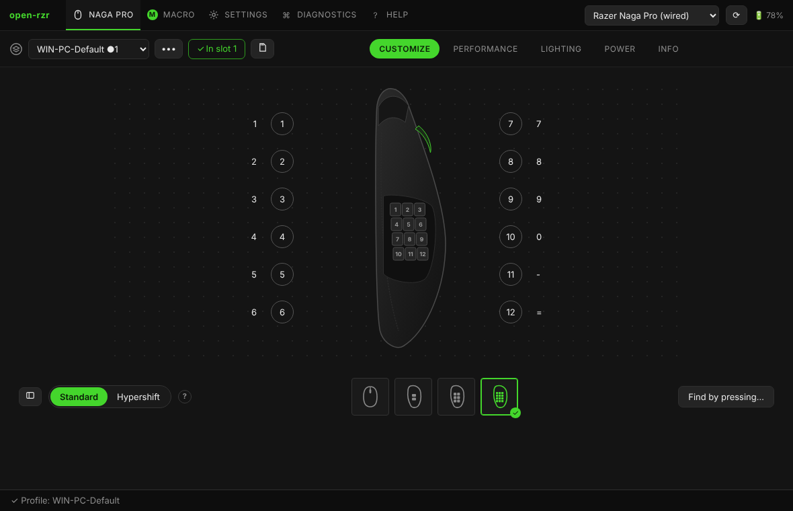

# Настройка: кнопки, Hypershift, турбо

На странице **Настройка** — рисунок мыши, у каждой кнопки подписано её назначение. Нажмите на подпись (или на кнопку на рисунке), чтобы изменить её; правый клик — меню кнопки.

## Виды и боковые панели

Кнопки под рисунком переключают вид: **сверху** и три **боковые панели** Naga Pro (2, 6 и 12 кнопок). Установленная панель определяется автоматически и отмечена ✓; смените панель — страница переключится сама. Назначения всех панелей хранятся в профиле, так что панель можно настроить заранее.

**▤ список** — все кнопки таблицей, включая скрытые (*Показать все*). **Найти нажатием…** — нажмите кнопку мыши, и страница покажет, какая это.

## Типы назначений

| Тип | Что делает |
|---|---|
| Клавиатура | клавиша или сочетание (Ctrl, Shift, Alt, Win + клавиша). **Другая клавиша** — клавиши, которых может не быть на клавиатуре: F13–F24, цифровой блок, медиа |
| Мышь | левая, правая, средняя, назад, вперёд, колесо вверх/вниз/влево/вправо; клик или двойной клик |
| Макрос | макрос из памяти мыши: N раз, пока зажата, вкл/выкл, по шагам |
| DPI | следующая / предыдущая стадия, конкретная стадия, **снайпер** (DPI, пока зажата) |
| Профиль | следующий / предыдущий профиль в памяти, конкретный |
| Мультимедиа | пуск/пауза, громкость, следующий трек… |
| Система | питание, сон, пробуждение |
| Hypershift | кнопка включает второй слой (ниже) |
| Режим прокрутки | свободное вращение колеса или по шагам |
| Отключено | кнопка ничего не делает |
| По умолчанию | заводское назначение этой кнопки |

**Нажатие колеса вбок** называется *Колесо: нажатие влево / вправо*; у Naga Pro по умолчанию оно листает вверх и вниз.

## Турбо

В окне назначения: **Турбо — Повторять, пока кнопка зажата** и интервал (по умолчанию 50 мс, 20 нажатий в секунду).

- **Кнопки мыши и клавиши** — повторяет сама мышь, программа не нужна.
- **Макросы** — макрос проигрывается снова и снова, пока кнопка зажата (режим *пока зажата*).
- **Медиа-клавиши** — у мыши для них нет турбо, поэтому open-rzr записывает маленький **служебный макрос** (номер от 0xF000) и назначает его *пока зажата*. Он занимает один макрос в памяти мыши и не показывается в списке макросов.
- DPI, профиль, Hypershift, Отключено — повтор для них не имеет смысла.

## Hypershift

Hypershift — **второй слой назначений**: пока зажата кнопка с назначением *Hypershift*, остальные кнопки работают по своим назначениям слоя Hypershift. Слои переключаются кнопками **Обычный слой / Слой Hypershift** под рисунком.

1. **Назначьте кнопку Hypershift**: правый клик по кнопке → *Сделать кнопкой Hypershift* (удобнее всего боковая клавиша под большим пальцем). Она остаётся *Hypershift* в обоих слоях, помечена **⇧** и не меняется в слое Hypershift.
2. Переключитесь на **слой Hypershift** и назначьте остальные кнопки. Слой показывает то, что действительно записано в мышь: пустое назначение — **Не назначено**, обычное не подставляется.
3. **•••** рядом с переключателем слоёв: *Скопировать стандартный → Hypershift* (начать с копии), *Очистить слой Hypershift*.

Подсказки под рисунком предупреждают, если в профиле есть назначения Hypershift, но нет кнопки Hypershift (они никогда не сработают), или кнопка есть, а слой пуст.

Макросы и F13–F24 работают в любом слое.
