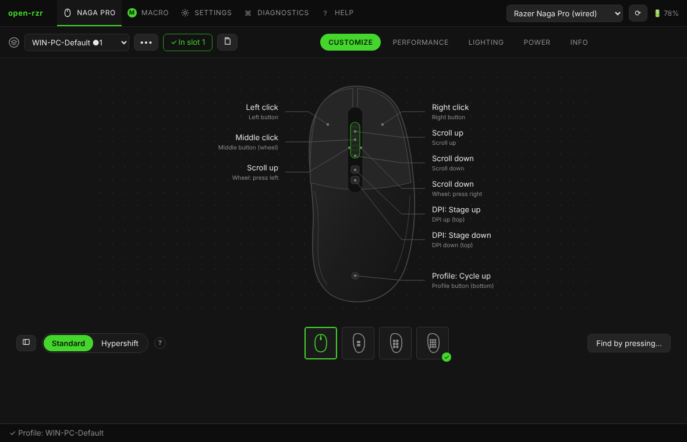

# Начало работы

open-rzr настраивает мыши Razer в Windows и Linux без Razer Synapse: без учётной записи, аналитики и интернета. Всё, что вы настроили, записывается в мышь и работает на любом компьютере — даже там, где open-rzr не установлена.

## Первый запуск

1. **Закройте Razer Synapse.** Synapse и open-rzr, обращаясь к мыши одновременно, получают ответы друг друга. Если ПО Razer запущено, сверху появится предупреждение с кнопкой **Остановить ПО Razer** (Windows попросит права администратора). Подробнее — [Windows и Razer Synapse](windows.md).
2. **Только Linux:** разрешите доступ к мыши. При первом запуске open-rzr предложит установить правило udev (один раз, с паролем). Подробнее — [Linux](linux.md).
3. **Выберите мышь** в списке справа сверху. Кабель, приёмник HyperSpeed и Bluetooth — отдельные строки.
4. **Сделайте резервную копию** до первых изменений: *••• → Резервная копия* рядом с профилем. Сохраняются все профили в памяти мыши, оба слоя и макросы.

## Окно

| Вкладка | Что на ней |
|---|---|
| **Мышь** (её название) | выбор профиля и подвкладки **Настройка**, **Производительность**, **Подсветка**, **Питание**, **Сведения** |
| **Макросы** | редактор и библиотека макросов |
| **Настройки** | язык, стиль окна, автозапуск, трей, профили, OpenRazer, Razer Synapse, о программе |
| **Диагностика** | журнал, отчёт, все HID-устройства, драйверы, команды вручную |
| **Справка** | это руководство |

Вкладки, которые мышь не поддерживает, скрыты. Значок **?** рядом с настройкой открывает нужный раздел руководства.

## Язык и стиль

**Настройки → Язык**: английский или русский. **Настройки → Стиль окна**: как в оригинальной программе (вкладки сверху) или классический open-rzr (боковая панель).

## Дальше

- [Профили и запись в мышь](profiles.md)
- [Настройка: кнопки, Hypershift, турбо](customize.md)
- [Макросы](macros.md)
