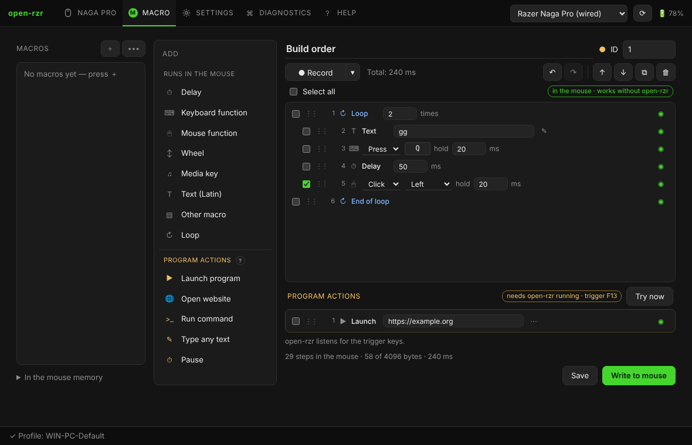

# Макросы

Вкладка **Макросы**: слева библиотека, в центре — что можно добавить, справа — шаги.

## Два вида шагов

| Выполняет мышь | Действия программы |
|---|---|
| пауза, функция клавиатуры, функция мыши, колесо, медиа-клавиша, текст (латиница), другой макрос, цикл | запуск программы, открытие сайта, команда, ввод любого текста, пауза |
| записываются в мышь; работают на любом компьютере, без open-rzr | нужна запущенная open-rzr (достаточно трея) |

### Выполняет мышь

- **Функция клавиатуры** — нажатие (с временем удержания), нажать и держать, отпустить.
- **Функция мыши** — клик, нажать, отпустить кнопку мыши.
- **Текст (латиница)** — мышь печатает его нажатиями в английской раскладке: латинские буквы, цифры, символы ASCII. Для других языков — *Ввести любой текст* в действиях программы.
- **Другой макрос** — вставляется на своё место.
- **Цикл** — шаги между *Цикл* и *Конец цикла* повторяются (при записи разворачиваются). Если шаги выбраны, *Цикл* обрамляет их.

open-rzr собирает это в макрос мыши. Строка под шагами показывает число шагов, размер (не больше **4096 байт**) и общее время. Выключенные шаги (◉ / ○) остаются в макросе, но не записываются.

### Действия программы

Мышь не умеет запускать программы и печатать кириллицу, поэтому эти действия вынесены отдельно: записанный в мышь макрос в конце нажимает свободную клавишу **F13–F24**, а open-rzr, увидев её, выполняет действия. Значок показывает, какая это клавиша; **Проверить** выполняет действия сразу.

- **Windows** — клавиши-триггеры регистрируются как горячие клавиши; другие программы их не получают.
- **Linux** — open-rzr читает собственный клавиатурный интерфейс мыши (`/dev/input/event*`; правило udev даёт доступ только к узлам мышей Razer), поэтому работает и в X11, и в Wayland. Для ввода текста нужен `xdotool` (X11) или `wtype` / `ydotool` (Wayland).

## Редактирование

- Каждый шаг правится прямо в списке: числа, клавиши (нажмите на клавишу и нажмите новую), списки.
- Галочки выбирают шаги; Shift+щелчок — диапазон, Ctrl+щелчок — добавить один.
- Перетащите за **⋮⋮**, чтобы переместить шаг (или все выбранные).
- **↑ ↓** перемещают выбранные, **⧉** дублирует, **🗑** удаляет.
- **Ctrl+Z / Ctrl+Y** — отменить / повторить, **Ctrl+D** — дублировать, **Del** — удалить.

## Запись

**● Запись** — печатайте, кликайте и крутите колесо в области записи, затем **■ Стоп**. **▾** рядом выбирает паузы (реальные, фиксированные, без пауз) и запись кнопок мыши. Запись работает только в этой области: open-rzr не ставит глобальный перехват клавиатуры.

## Сохранение и запись

- **Сохранить** — в библиотеку на этом компьютере (макрос сохранится, даже если пока не помещается в мышь).
- **Записать в мышь** — собрать и записать под его **ID**; затем назначьте его на кнопку на странице *Настройка* (тип *Макрос*).
- **В памяти мыши** (слева внизу) — что сейчас в мыши и сколько свободно флеш-памяти; отсюда макрос можно стереть.
